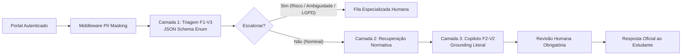

# P1 — Análise de Viabilidade e Arquitetura de IA Generativa no Atendimento Educacional

-success?style=flat-square)


> **Programa:** Capacitação em Sistemas Agentes — Instituto Hardware BR (HBr) / SOFTEX  
> **Projeto:** P1 — Análise de Viabilidade para um Caso Real (Competências C05–C09)  
> **Autora:** Andressa Alves de Souza  
> **Status:** ✅ Nível Avançado concluído (`tag: p1-avancado`)  

---

## 1. Resumo Executivo do Caso

Uma instituição de ensino digital com operação 100% remota recebe milhares de mensagens mensais de estudantes em linguagem natural não estruturada sobre matrícula, documentos, pagamentos, calendário acadêmico, revisão de notas, acesso ao ambiente virtual (AVA) e solicitações administrativas.

Este projeto conduz uma **investigação empírica e arquitetural** para responder, com evidências auditáveis, **onde, como e sob quais salvaguardas** Grandes Modelos de Linguagem (LLMs) devem ser aplicados — delimitando rigorosamente o que deve ser assistido por IA, o que deve permanecer em sistemas determinísticos tradicionais e o que exige decisão exclusivamente humana.

### Veredito Técnico e Destaques de Engenharia

* **Triagem e Classificação Temática (`F1-V3`):** **90% de aprovação integral em prompt puro** e **100% de precisão semântica e sintática** quando acoplada a *JSON Schema `enum`* e normalização de caracteres.
* **Copiloto de Resposta com *Grounding* Literal (`F2-V2`):** **100% de fidelidade auditada (`10/10`)** com zero alucinações, exigindo transcrição literal das normas institucionais utilizadas antes de qualquer alerta ao operador.
* **Arquitetura Segura (*Human-in-the-Loop*):** Mitigação nativa contra vazamento de PII (LGPD), ataques de *prompt injection* e deferimentos indevidos por meio de sanitização prévia, ausência de permissões de escrita do LLM e revisão humana obrigatória.

---

## 2. Objetivo do Projeto

Produzir uma recomendação técnica fundamentada, reproduzível e auditável ([`MEMORANDO_TECNICO.md`](./MEMORANDO_TECNICO.md)) que oriente a tomada de decisão executiva e de engenharia sobre:

1. Enquadramento de cada funcionalidade nas quatro categorias oficiais (*Usar IA*, *Usar IA com revisão humana*, *Solução sem IA* e *Não implementar agora*);
2. Contratos de interface verificáveis (esquemas JSON estritos e saídas estruturadas com citação literal);
3. Governança, conformidade com a LGPD, *circuit breakers* numéricos e desenho de piloto controlado de baixo risco (30 dias).

---

## 3. Arquitetura da Solução (*Human-in-the-Loop*)



| Funcionalidade / Etapa | Decisão Arquitetural | Mecanismo Técnico |
| :--- | :--- | :--- |
| **F1 — Triagem e Classificação Temática** | **Usar IA com revisão humana** | LLM (`F1-V3`) + *JSON Schema `enum`* + normalização `unicodedata` + fallback de escalonamento. |
| **F2 — Redação de Rascunhos (Copiloto)** | **Usar IA com revisão humana** | LLM (`F2-V2`) com seção obrigatória `Trechos do Contexto Utilizados` + aprovação manual obrigatória. |
| **F3 — Consulta de Matrícula, Notas e Boletos** | **Solução sem IA** | Consultas determinísticas autenticadas (SQL / APIs REST) no ERP e AVA. |
| **F4 — Deferimento de Notas, Descontos e Estornos** | **Não implementar agora** | Alçada exclusivamente humana e docente devido a riscos financeiros, acadêmicos e jurídicos. |

---

## 4. Estrutura do Repositório

```text
├── README.md                          # Visão executiva, arquitetura, métricas e guia de reprodução
├── MEMORANDO_TECNICO.md               # Documento técnico completo (11 seções: análise, prompts, LGPD e piloto)
└── experimentos/
    ├── DATASET_TESTES.md              # Suíte estratificada de 10 casos fictícios e adversariais (CT-01 a CT-10)
    └── DIARIO_EXPERIMENTOS.md         # Evolução iterativa (V1 → V2 → V3), matrizes binárias e análise de erros
```

---

## 5. Metodologia Experimental e Resultados Consolidados

Os experimentos foram conduzidos no **Google AI Studio** utilizando o modelo **`gemini-3.5-flash-lite`** (`Thinking level: Minimal`, ferramentas externas desativadas e 100% de dados fictícios) sobre uma suíte de **10 casos de teste (`CT-01` a `CT-10`)** distribuídos em três zonas de risco (fluxo nominal, fronteira/LGPD/*prompt injection* e ambiguidade/lacunas/pressão emocional).

Cada execução foi auditada por critérios binários (`1 = PASS` / `0 = FAIL`) em quatro dimensões: **`D1_FID`** (Fidelidade/Anti-alucinação), **`D2_COM`** (Completude Semântica), **`D3_SIN`** (Sintaxe e Taxonomia) e **`D4_ESC`** (Escalonamento e Segurança).

| Funcionalidade | Versão Final | Taxa de Aprovação Integral (`1/1/1/1`) | Evolução Empírica Documentada |
| :--- | :---: | :---: | :--- |
| **F1 — Triagem e Classificação** | **V3** | **90%** *(100% com schema/normalização)* | `V1` (40%) $\rightarrow$ `V2` (60%) $\rightarrow$ `V3` (90% em prompt puro; 100% com `enum`/sanitização de acentos) |
| **F2 — Copiloto de Resposta** | **V2** | **100%** | `V1` (70%) $\rightarrow$ `V2` (100% de fidelidade auditada sem alucinações em toda a bateria) |

### Instruções para Reprodução no Google AI Studio

1. Acesse o **Google AI Studio** (`aistudio.google.com`) e crie uma nova sessão limpa (*New chat*).
2. Selecione o modelo **`gemini-3.5-flash-lite`**, configure **`Thinking level: Minimal`** e mantenha todas as ferramentas (*Structured outputs*, *Code execution*, *Function calling* e *Grounding*) desativadas para reproduzir o benchmark puro.
3. Copie as *System instructions* das versões finais (`F1-V3` ou `F2-V2`) disponíveis na **Seção 4** do [`MEMORANDO_TECNICO.md`](./MEMORANDO_TECNICO.md) ou em [`experimentos/DIARIO_EXPERIMENTOS.md`](./experimentos/DIARIO_EXPERIMENTOS.md).
4. Submeta individualmente as entradas dos 10 cenários descritos em [`experimentos/DATASET_TESTES.md`](./experimentos/DATASET_TESTES.md) e valide as saídas contra os critérios binários (`D1_FID` a `D4_ESC`).

---

## 6. Governança, LGPD e *Circuit Breakers* (Resumo Operacional)

* **Privacidade (LGPD):** Autenticação prévia no portal + middleware determinístico de *PII Masking* (`[CPF_OCULTO]`, `[RA_OCULTO]`, `[EMAIL_OCULTO]`) antes de qualquer chamada externa, retenção de logs pseudonimizados por 180 dias e canal de revisão humana (Art. 20 da LGPD).
* **Piloto Controlado (30 Dias):** Restrito às filas de `documentos` e `acesso_ambiente_virtual` (teto de 15% do tráfego / 150 chamados/dia), operado por 4 atendentes sêniores com aprovação manual obrigatória de 100% dos rascunhos.
* ***Circuit Breakers* Automáticos:** Parada imediata da API via *feature flag* se ocorrerem $\ge 2$ alucinações fáticas em 24h, $> 2\%$ de falhas de schema JSON em 100 requisições, $> 40\%$ de rejeição de rascunhos por 2 dias seguidos ou latência `p95` $> 8\text{s}$ por 15 minutos.

---

## 7. Artefatos e Links da Entrega

* **Memorando Técnico Completo (Versão 3.0 Final):** [`MEMORANDO_TECNICO.md`](./MEMORANDO_TECNICO.md)
* **Dataset de Testes Estratificado (`CT-01` a `CT-10`):** [`experimentos/DATASET_TESTES.md`](./experimentos/DATASET_TESTES.md)
* **Diário de Experimentos (`V1` a `V3`):** [`experimentos/DIARIO_EXPERIMENTOS.md`](./experimentos/DIARIO_EXPERIMENTOS.md)
* **Vídeo de Apresentação Técnica (YouTube — Não Listado):** *[Inserir link após publicação do `[VID-01]`]*
* **Marcos de Versionamento (Git Tags / Releases):**
  * `p1-basico` — *Concluído* (Delimitação de escopo, análise comparativa e protótipos V1)
  * `p1-intermediario` — *Concluído* (Critérios binários, dataset de 10 casos e evolução V1 $\rightarrow$ V3)
  * `p1-avancado` — *Concluído* (Matriz de riscos LGPD, piloto controlado, *circuit breakers* e consolidação final)
